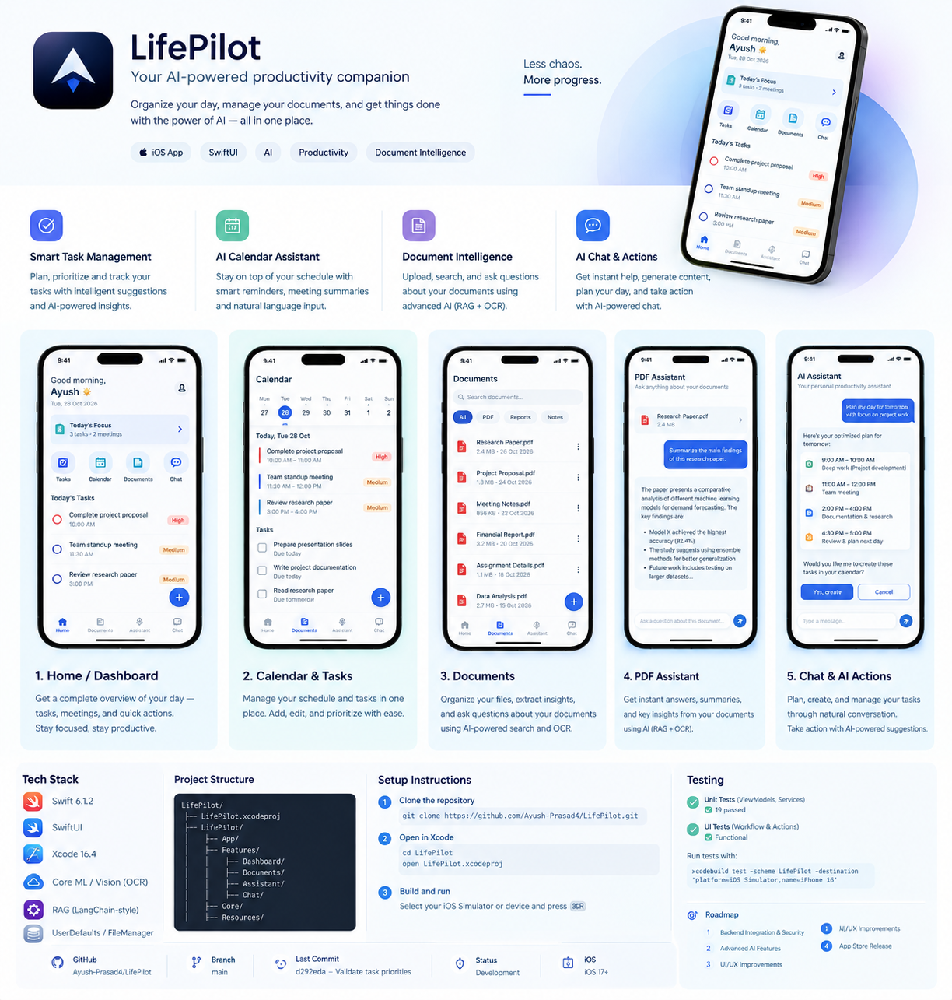
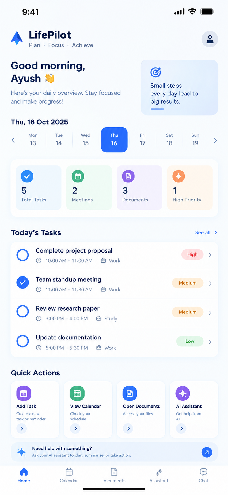
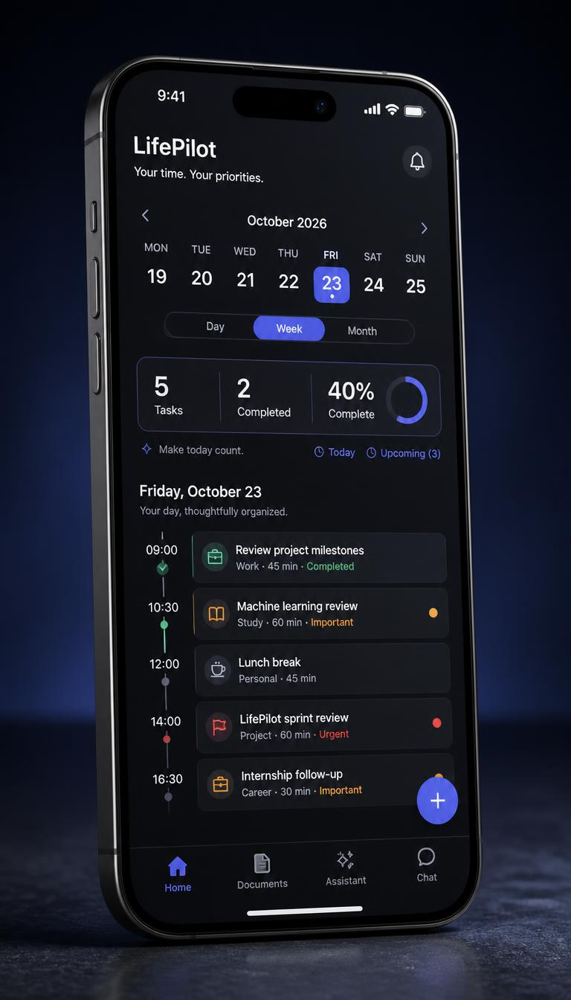
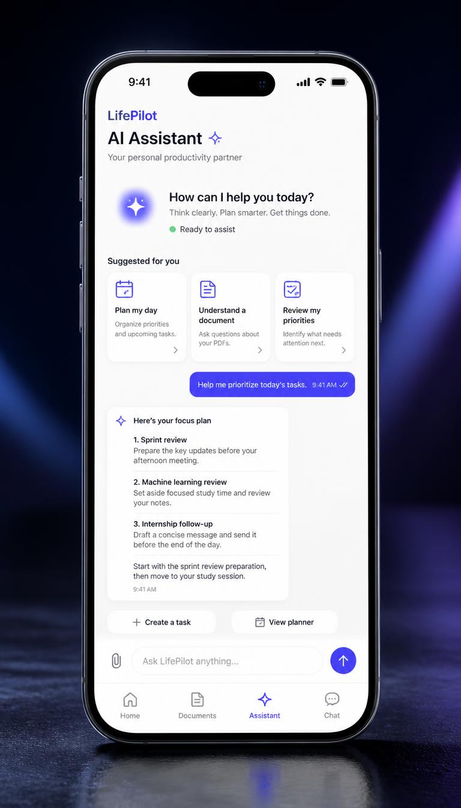
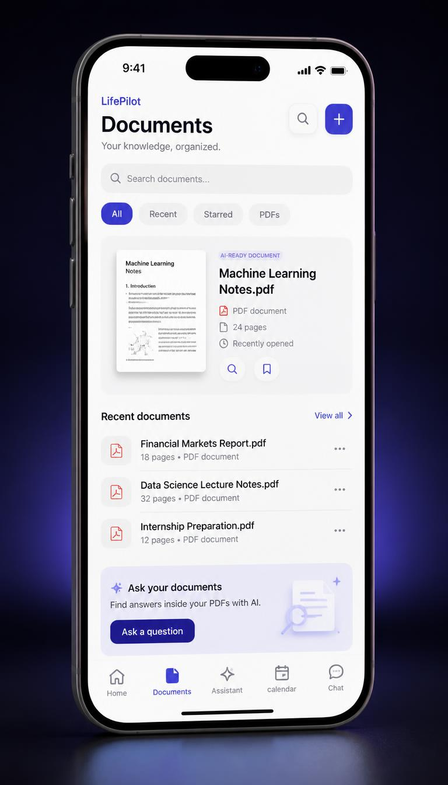

# LifePilot — AI-Powered Work & Productivity

**Less chaos. More progress.**

LifePilot is a native iOS productivity application designed to help professionals organize tasks, manage work documents, and take action through an AI-powered assistant — all from one workspace.

<p align="center">
  
</p>

<p align="center">
  
  
  
  
  
</p>

---

## Overview

LifePilot brings task management, planning, document intelligence, and AI-assisted workflows together in a focused native iOS experience.

### Core Capabilities

- **Task management** — Create, edit, complete, delete, and prioritize tasks.
- **Calendar & planning** — Organize deadlines and manage scheduled tasks.
- **AI assistant** — Ask questions, discuss task context, and prepare task operations using natural language.
- **PDF intelligence** — Work with PDF documents, extract text using OCR, and ask questions about document content.
- **Safe AI actions** — Review proposed task changes and explicitly confirm or cancel them.
- **Local persistence** — Retain planner tasks and document metadata between app sessions.

## App Screens

### 01 — Home & Dashboard

<p align="center">
  
</p>

The central workspace for viewing productivity summaries and accessing the app's main features.

**Highlights**
- View dashboard summaries and quick entry points.
- Navigate to documents, planning, and AI assistance.
- Access productivity-related information from a unified interface.

### 02 — Calendar & Tasks

<p align="center">
  
</p>

Manage daily responsibilities and keep track of important work.

**Highlights**
- Create and edit tasks.
- Manage due dates and completion status.
- Assign Normal, Important, or Urgent priority.
- Complete tasks and delete them with confirmation.
- Validate task details before applying changes.
- Persist planner tasks locally on the device.

### 03 — AI Assistant

<p align="center">
  
</p>

Use conversational AI for productivity questions, task context, and document-focused assistance.

**Highlights**
- Ask general questions and continue conversations.
- Discuss task titles, due dates, priorities, and completion status.
- Work with supported PDF documents.
- Extract document text using PDFKit and Apple Vision OCR.
- Ask questions using supplied document evidence.
- Receive document-grounded answers with source and page references.
- Generate proposed task actions and review them before confirmation.

### 04 — Documents & PDF Intelligence

<p align="center">
  
</p>

Manage PDFs and use AI-assisted document workflows from one organized library.

**Highlights**
- Browse and open stored PDF documents.
- Extract document text using PDFKit and Apple Vision OCR.
- Ask questions using relevant document evidence.
- Access document-focused AI assistance.

### AI-Assisted Task Actions

LifePilot supports proposed task creation, editing, completion, and deletion through a controlled confirmation workflow. AI-generated proposals are validated before being applied, and invalid operations are rejected rather than silently changing the task list.

---

## Technical Architecture

| Layer | Responsibility |
|---|---|
| Presentation | Native SwiftUI screens and navigation |
| View models | UI state and dashboard workflows |
| Domain | Task, priority, and document models |
| Persistence | Local task and document metadata storage |
| Document processing | PDFKit and Vision OCR |
| Backend | Python and FastAPI |
| AI integration | OpenAI Responses API |
| Validation | Pydantic request and response models |
| Testing | pytest, unit tests, and UI regression tests |

## Technology Stack

- **Swift & SwiftUI** — Native iOS development
- **MVVM** — Separation of dashboard presentation and business logic
- **PDFKit** — PDF document handling
- **Apple Vision** — Optical character recognition
- **UserDefaults & JSON** — Local planner and document metadata persistence
- **Python & FastAPI** — Backend API
- **OpenAI API** — Conversational AI and document-grounded answers
- **pytest** — Backend testing

## Backend API

| Method | Endpoint | Purpose |
|---|---|---|
| `GET` | `/health` | Check API health |
| `POST` | `/v1/chat` | Conversational AI with optional task context |
| `POST` | `/v1/answer` | Answer questions using supplied document evidence |
| `POST` | `/v1/chat/actions` | Generate structured task-action proposals |

The document-answering endpoint is designed to use supplied excerpts rather than assume unrestricted access to every document. Task-action proposals require user confirmation in the iOS app.

## Project Structure

```text
LifePilot/
├── ios/
│   └── LifePilot/
│       ├── LifePilot/
│       │   ├── ContentView.swift
│       │   ├── Data/
│       │   └── Features/
│       │       ├── Dashboard/
│       │       ├── Documents/
│       │       ├── Assistant/
│       │       └── Chat/
│       ├── LifePilotTests/
│       └── LifePilotUITests/
├── backend/
│   ├── app/
│   │   └── main.py
│   ├── tests/
│   │   └── test_main.py
│   └── requirements.txt
├── docs/
│   └── images/
│       ├── lifepilot-overview.png
│       ├── home-dashboard.png
│       ├── calendar-tasks.jpg
│       ├── ai-assistant.jpg
│       └── documents-library.jpg
└── README.md
```

## Getting Started

### Requirements

- macOS with Xcode
- An available iOS Simulator or compatible iPhone
- Python 3.11 or newer for the backend
- An OpenAI API key for AI-powered backend functionality

### Run the iOS App

Clone the repository:

```bash
git clone https://github.com/Ayush-Prasad4/LifePilot.git
cd LifePilot
```

Open the Xcode project in the repository's iOS directory, select the `LifePilot` scheme and an available simulator, then build and run.

### Run the Backend

From the repository root:

```bash
cd backend
python3 -m venv .venv
source .venv/bin/activate
pip install -r requirements.txt
```

Create `backend/.env` with your server-side API configuration:

```dotenv
OPENAI_API_KEY=your_openai_api_key
OPENAI_MODEL=gpt-5-mini
```

Start the development server from the `backend` directory:

```bash
uvicorn app.main:app --reload --host 0.0.0.0 --port 8000
```

Check `http://127.0.0.1:8000/health` to verify that the local API is responding. The iOS app's configured base URL must point to the reachable backend address.

**Security:** Never commit API keys to source control. Use HTTPS, appropriate access controls, and secure secret management for production deployments.

## Quality & Testing

Development testing covers important API and task-management behaviours, including:

- Dashboard view-model behaviour.
- Task creation and editing validation.
- Priority validation.
- Pending-action confirmation and cancellation.
- Document-answer request validation.
- Chat history and task-context handling.
- Invalid task-action regression cases.

The latest recorded backend regression run completed with **19 passing tests**. This is a historical result; simulator and UI-test coverage should be verified against the latest build before release.

## Roadmap

- Strengthen calendar and task workflows.
- Improve AI assistant reliability and action validation.
- Expand PDF retrieval and document intelligence.
- Improve persistence and error handling.
- Strengthen backend integration and security.
- Polish accessibility and interface consistency.
- Complete release preparation and TestFlight validation.

## Project Status

LifePilot is an actively developed portfolio project exploring native iOS engineering, AI-assisted productivity, document intelligence, and user-confirmed AI actions.

## Author

**Ayush Prasad**

- GitHub: [@Ayush-Prasad4](https://github.com/Ayush-Prasad4)
- Portfolio: [ayushprasad.dev](https://ayushprasad.dev/)

---

<p align="center">
  <strong>LifePilot</strong><br>
  Plan your work. Understand your documents. Move forward with clarity.
</p>
